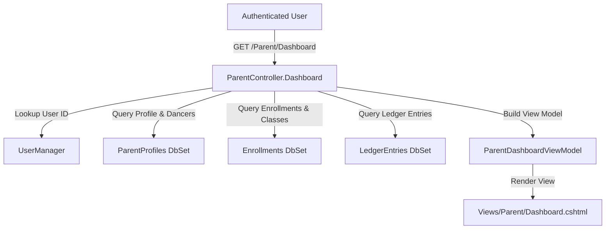

# Requirements

### Overview & Goals
The objective is to fix two compilation and data loading issues in `ParentController.cs` (`Dashboard` action):
1. Resolve the missing `_context.LedgerEntries` symbol by registering `DbSet<LedgerEntry> LedgerEntries` in `ApplicationDbContext`.
2. Satisfy the required `Profile` property and related data dependencies (`Dancers`, `EnrolledClasses`) when constructing `ParentDashboardViewModel` in `ParentController.Dashboard()`.

### Scope
- **In Scope:**
  - Register `DbSet<LedgerEntry> LedgerEntries` in `EatonvilleDanceStudio/Data/ApplicationDbContext.cs`.
  - Update `ParentController.cs` to fetch `ParentProfile` with `Dancers` and associated `Enrollments`, properly initializing `ParentDashboardViewModel`.
  - Add comprehensive unit tests verifying `ParentController` behavior.
- **Out of Scope:**
  - Changes to Stripe payment processing logic in `PaymentController`.
  - Modifications to Razor view layouts or styling in `Views/Parent/Dashboard.cshtml`.

### User Stories
- **As a Parent**, I want to navigate to `/Parent/Dashboard` and see my contact profile, current balance, recent charges/payments, enrolled classes, and dancers so that I have a complete overview of my family's studio activities and finances.

### Functional Requirements
- When an authorized parent requests `/Parent/Dashboard`:
  - The controller queries the database for the parent profile matching `UserManager.GetUserId(User)`.
  - If no profile exists for the user, return `NotFound`.
  - Retrieve the parent's dancers and their associated enrollments (with class information).
  - Retrieve the parent's ledger entries from `_context.LedgerEntries` ordered newest first.
  - Populate `ParentDashboardViewModel` with `Profile`, `Dancers`, `EnrolledClasses`, `CurrentBalance`, `RecentCharges`, and `RecentPayments`.
  - Pass the populated model to `Views/Parent/Dashboard.cshtml`.

# Technical Design

### Current Implementation
- `ParentController.cs` currently fails to compile with two errors:
  1. `CS1061: 'ApplicationDbContext' does not contain a definition for 'LedgerEntries'`: `_context.LedgerEntries` cannot be resolved because `ApplicationDbContext` lacks `public DbSet<LedgerEntry> LedgerEntries { get; set; }`.
  2. `CS9035: Required member 'ParentDashboardViewModel.Profile' must be set in the object initializer`: `ParentDashboardViewModel` defines `public required ParentProfile Profile { get; set; }`, but `Dashboard()` in `ParentController` instantiates `ParentDashboardViewModel` setting only `CurrentBalance`, `RecentCharges`, and `RecentPayments`. In addition, `Views/Parent/Dashboard.cshtml` accesses `Model.Profile`, `Model.Dancers`, and `Model.EnrolledClasses`, which would cause runtime null reference exceptions if unassigned.

### Key Decisions
- **Register `LedgerEntries` in `ApplicationDbContext`:**
  - Add `public DbSet<LedgerEntry> LedgerEntries { get; set; }` in `ApplicationDbContext.cs` following the pattern used for other entities (`ParentProfiles`, `Dancers`, `DanceClasses`, `Enrollments`).
- **Complete Dashboard Query Flow in `ParentController.Dashboard()`:**
  - Fetch `ParentProfile` with `Include(p => p.Dancers)` matching `p.UserId == userId`.
  - If `parentProfile == null`, return `NotFound("Parent profile not found")`.
  - Query `Enrollments` where `DancerId` belongs to the parent's dancers, including `DanceClass` and `Dancer`.
  - Fetch `LedgerEntries` where `ParentId == userId` ordered descending by `TransactionDate`.
  - Initialize `ParentDashboardViewModel` with all required and dependent properties populated.

### Proposed Changes
1. **`EatonvilleDanceStudio/Data/ApplicationDbContext.cs`**:
   - Add `public DbSet<LedgerEntry> LedgerEntries { get; set; }`.
2. **`EatonvilleDanceStudio/Controllers/ParentController.cs`**:
   - Update `Dashboard()` to:
     ```csharp
     var userId = _userManager.GetUserId(User);
     if (userId == null) return Unauthorized();

     var parentProfile = await _context.ParentProfiles
         .Include(p => p.Dancers)
         .FirstOrDefaultAsync(p => p.UserId == userId);

     if (parentProfile == null) return NotFound("Parent profile not found");

     var dancerIds = parentProfile.Dancers.Select(d => d.Id).ToList();
     var enrolledClasses = await _context.Enrollments
         .Include(e => e.DanceClass)
         .Include(e => e.Dancer)
         .Where(e => dancerIds.Contains(e.DancerId))
         .ToListAsync();

     var ledgerEntries = await _context.LedgerEntries
         .Where(l => l.ParentId == userId)
         .OrderByDescending(l => l.TransactionDate)
         .ToListAsync();

     var viewModel = new ParentDashboardViewModel
     {
         Profile = parentProfile,
         Dancers = parentProfile.Dancers.ToList(),
         EnrolledClasses = enrolledClasses,
         CurrentBalance = ledgerEntries.Sum(l => l.Amount),
         RecentCharges = ledgerEntries.Where(l => l.Amount > 0).ToList(),
         RecentPayments = ledgerEntries.Where(l => l.Amount <= 0).ToList()
     };

     return View(viewModel);
     ```

### Architecture Diagram


### File Structure
- `EatonvilleDanceStudio/Data/ApplicationDbContext.cs` (modified: added `LedgerEntries` DbSet)
- `EatonvilleDanceStudio/Controllers/ParentController.cs` (modified: fixed `Dashboard` action)
- `tests/EatonvilleDanceStudio.Tests/ParentControllerTests.cs` (added: unit tests)

### Risks
- **Null ParentProfile:** If a user account exists without a completed parent profile, navigating to `/Parent/Dashboard` must return `NotFound` rather than throwing an exception.

# Testing

### Validation Approach
- Verify solution compilation with `dotnet build EatonvilleDanceStudio.sln`.
- Execute automated tests to validate controller logic and view model construction.

### Key Scenarios
- **Scenario 1: Happy Path Dashboard Loading**
  - Given a logged-in user with an existing `ParentProfile`, associated `Dancers`, `Enrollments`, and `LedgerEntries`.
  - When the parent requests `Dashboard()`.
  - Then a `ViewResult` is returned containing a `ParentDashboardViewModel` with populated `Profile`, `Dancers`, `EnrolledClasses`, `CurrentBalance`, `RecentCharges`, and `RecentPayments`.
- **Scenario 2: Missing Parent Profile**
  - Given a logged-in user without a corresponding `ParentProfile` in the database.
  - When the user requests `Dashboard()`.
  - Then `NotFoundResult` or `NotFoundObjectResult` is returned.
- **Scenario 3: Unauthenticated Access**
  - Given an unauthenticated context where `userId` is null.
  - When `Dashboard()` is called.
  - Then `UnauthorizedResult` is returned.

### Test Changes
- Create `tests/EatonvilleDanceStudio.Tests/ParentControllerTests.cs` with in-memory database test fixtures for `ParentController`.

# Delivery Steps

### ✓ Step 1: Expose LedgerEntries DbSet in ApplicationDbContext
The `ApplicationDbContext` class exposes the `LedgerEntries` DbSet so that financial transactions can be queried across the application.

- Add `public DbSet<LedgerEntry> LedgerEntries { get; set; }` to `EatonvilleDanceStudio/Data/ApplicationDbContext.cs`.
- Ensure proper entity mapping is maintained with existing models.

### ✓ Step 2: Fix ParentDashboardViewModel construction and data loading in ParentController
The `Dashboard` action in `ParentController` retrieves the logged-in parent's profile, dancers, enrollments, and ledger entries, correctly populating `ParentDashboardViewModel`.

- Retrieve the `ParentProfile` for the logged-in `userId` including associated dancers (`Include(p => p.Dancers)`).
- Handle cases where `parentProfile` is not found by returning a 404 `NotFound` response.
- Query active `Enrollments` for the parent's dancers, including `DanceClass` and `Dancer` navigation references.
- Construct `ParentDashboardViewModel` with `Profile`, `Dancers`, `EnrolledClasses`, `CurrentBalance`, `RecentCharges`, and `RecentPayments`.

### ✓ Step 3: Validate compilation and add unit tests for ParentController
The solution compiles cleanly without errors and unit tests verify parent dashboard data retrieval and dancer operations.

- Run `dotnet build EatonvilleDanceStudio.sln` to ensure zero compilation errors and warnings related to `ParentController`.
- Add unit tests in `tests/EatonvilleDanceStudio.Tests` covering `ParentController.Dashboard` (authorized user, profile mapping, ledger calculations, and null profile handling) and `ParentController.AddDancer`.
- Execute test runner to ensure all test suites pass.